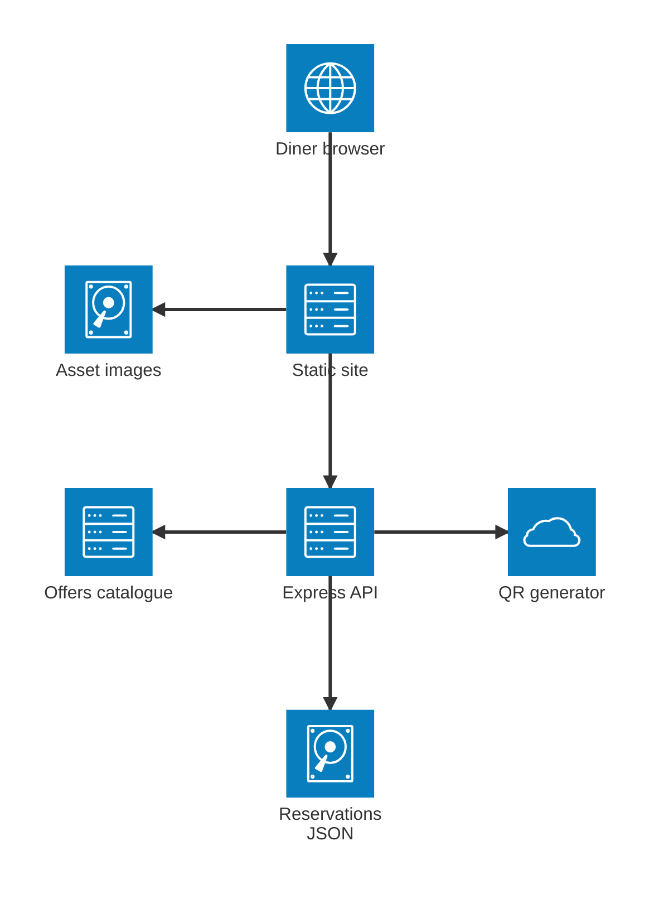
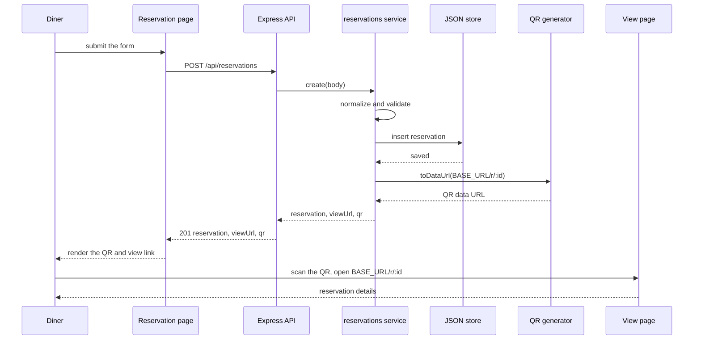

# Architecture

Byte2Bite is a restaurant reservation site. It pairs a static multi-page front end with a small Express API that validates a booking, stores it, and mints a QR code that links to a server-served detail page. This document describes the runtime pieces and how they connect, and complements `DFD.md` (data movement), `ERD.md` (data model), and `USE-CASE.md`.

The diagrams use Mermaid's `architecture-beta` syntax, which needs Mermaid 11.1.0 or newer. Icons mark each node type: `internet` for clients, `server` for compute, `database` for relational stores, `disk` for file and object storage, and `cloud` for managed services.

## Current architecture

The front end is plain HTML, CSS, and JavaScript with no build step: a home page with a hero carousel seeded from `lib/seed.js`, plus about, contact, and reservation pages. The reservation page posts to the Express API, which checks the chosen offer against the in-code catalogue, persists the reservation, generates a QR code, and returns the record, a view link, and the QR image. The QR encodes `BASE_URL/r/<id>`, which redirects to the server-served view page.

## Reservation and QR flow

A booking is created in one request. The API resolves the table and offer, validates the payload, writes the record, builds the view link, and returns the QR so the diner can open the same record on a phone.

## HTTP surface

| Method | Path | Purpose |
| --- | --- | --- |
| GET | `/health` | Liveness check with a timestamp. |
| GET | `/api/offers` | The offers a reservation can be bundled with. |
| GET | `/api/reservations` | List all reservations, newest first. |
| GET | `/api/reservations/:id` | Fetch one reservation. |
| POST | `/api/reservations` | Create a reservation, return the record, view link, and QR. |
| DELETE | `/api/reservations/:id` | Remove a reservation. |
| GET | `/api/reservations/:id/qr.png` | The QR for a reservation as a PNG. |
| GET | `/r/:id` | Redirect to `/view.html?id=:id` for the scanned QR. |

## Components

| Component | Path | Role |
| --- | --- | --- |
| Static site | `index.html`, `about/`, `contact/`, `reservation/` | Multi-page UI, no build step or framework. |
| Reservation page | `reservation/reservation.js` | Posts the booking to the API, renders the QR and link. |
| Express API | `server/src/app.js`, `server/src/routes/reservations.js` | HTTP surface, CORS, static mounts, error handling. |
| Reservations service | `server/src/services/reservations.js` | Validation, table and offer resolution, id minting. |
| Store | `server/src/services/store.js` | JSON-file persistence for reservations. |
| QR generator | `server/src/services/qr.js` | `qrcode` library, PNG buffer and data URL. |
| View page | `server/src/public/view.*` | Server-served reservation detail opened from the QR. |
| Offers catalogue | `server/src/data/offers.js` | Source of truth for offer ids, names, prices, images. |

## Data stores

| Store | Location | Key | Contents |
| --- | --- | --- | --- |
| Reservations | JSON file `server/data/reservations.json` | Reservation id | One row per booking: guest, contact, datetime, table, offer, special request. |
| Offers catalogue | In code `server/src/data/offers.js` | Offer id | Offer name, price, and image path used to build a reservation. |
| Home content | `lib/seed.js` | n/a | Carousel slides and drinks used by the home page. |
| Asset images | `/assets` (served by Express) | File path | Logo and offer posters referenced by the seed and by reservations. |

## Configuration

| Variable | Default | Effect |
| --- | --- | --- |
| `PORT` | `3000` | Port the Express server listens on. |
| `BASE_URL` | `http://localhost:3000` | Absolute base used to build the QR view link. |
| `DATA_FILE` | `server/data/reservations.json` | Where reservations are persisted. |
| `CORS_ORIGIN` | `*` | Allowed browser origin for API calls. |

## Design constraints

- The static site has no build step or framework; it reaches the API through a configured base URL on the reservation form (`data-api`).
- The offers catalogue is server side and authoritative, so clients cannot invent offer names or prices.
- Reservations persist to a single JSON file, which is single-writer and not concurrency safe. It suits a demo, not production traffic.
- The QR encodes an absolute URL built from `BASE_URL`, so that value must resolve from the diner's phone for the scan to work.
- CORS defaults to `*` and `BASE_URL` defaults to localhost; both are environment-configured for deployment.
