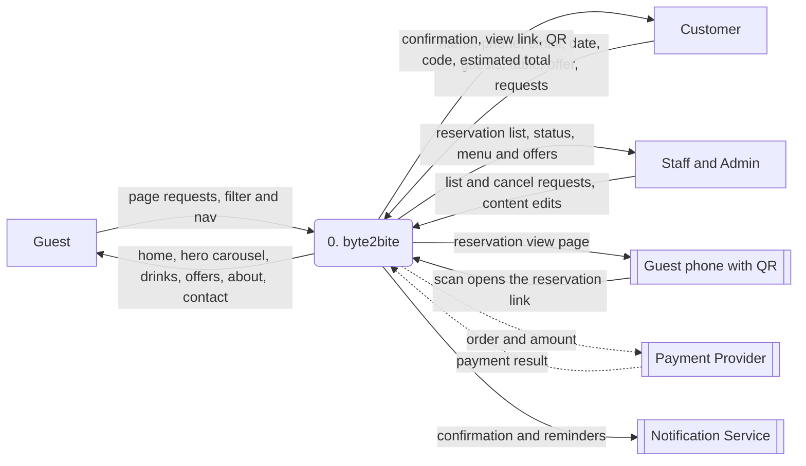
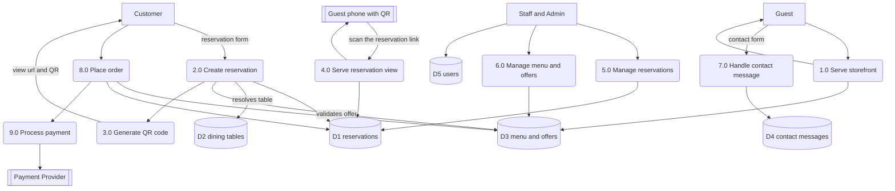

# DFD: Data Flow Diagram

This document models how data moves through byte2bite. It uses a Gane and Sarson style notation, rendered with Mermaid, and covers the system at two levels: the context diagram (Level 0) and the top-level decomposition (Level 1).

byte2bite has two parts. A static storefront (home with the hero carousel, drinks and offers, about, contact, and the reservation form) and an Express reservation service that stores reservations as JSON and issues QR codes so a reservation can be opened on any phone.

## Notation

| Symbol | Meaning | Mermaid shape |
| --- | --- | --- |
| Rectangle | External entity, a source or sink of data outside the system | `[Entity]` |
| Rounded rectangle | Process that transforms data | `("n.0 Process")` |
| Open-ended rectangle | Data store | `[("Dn store")]` |
| Arrow | Data flow, labelled with the data carried | `-->|label|` |

## Level 0: Context diagram

The system is a single process. External entities exchange data with it.

Flows marked with dotted lines are planned. Payment and notifications are not built yet.

## Level 1: Top-level decomposition

The system decomposes into nine processes and a set of data stores. The storefront processes are read only. The reservation service is the only writer today.

Processes 8.0 and 9.0 are planned. The storefront reads `lib/seed.js` through process 1.0.

## Process descriptions

| Process | Name | Input | Output | Stores |
| --- | --- | --- | --- | --- |
| 1.0 | Serve storefront | Page requests | Home, hero carousel, drinks, offers, about, contact | reads D3 |
| 2.0 | Create reservation | Form fields incl. offerId | Saved reservation, view url, estimated total | D1, D2, reads D3 |
| 3.0 | Generate QR code | Reservation view url | QR data url, QR png | none |
| 4.0 | Serve reservation view | Scanned id | Reservation view page with offer and total | reads D1 |
| 5.0 | Manage reservations | List and cancel actions | Reservation list, deletion | D1 |
| 6.0 | Manage menu and offers | Content edits | Updated menu and offers | D3 |
| 7.0 | Handle contact message | Name, email, subject, body | Stored message, notification | D4 |
| 8.0 | Place order | Cart, table | Order, total | D3, D1 |
| 9.0 | Process payment | Order, amount | Payment result | reads D1 |

The offer catalogue is also exposed read only at `GET /api/offers`, which returns the entries built from `offers_seed` by `server/src/data/offers.js`.

## Data stores

| Store | Holds | Written by | Read by |
| --- | --- | --- | --- |
| D1 reservations | Reservation rows as JSON | 2.0, 5.0 | 2.0, 4.0, 5.0 |
| D2 dining tables | Table id, name, seats | none (constant) | 2.0, 4.0 |
| D3 menu and offers | Carousel, drinks, offers, currency | none (seed data) | 1.0, 2.0, 8.0 |
| D4 contact messages | Contact submissions | 7.0 | 7.0 |
| D5 users | Staff and admin accounts | 7.0 (admin) | all |

## Key data flows

| Flow | From | To | Data |
| --- | --- | --- | --- |
| Reservation form | Customer | 2.0 Create reservation | name, phone, email, datetime, guests, tableId, offerId, special |
| Normalize | 2.0 Create reservation | module | Trailing spaces trimmed, guests clamped to 1 to 10, table resolved (leading `table-` stripped), offer validated against the catalogue |
| Offer catalogue | D3 menu and offers | 2.0 Create reservation | Offer id, name, image, price for the chosen offer |
| Insert | 2.0 Create reservation | D1 | Reservation object with id, createdAt, and an offer snapshot |
| QR generation | 2.0 Create reservation | 3.0 Generate QR code | View url `${BASE_URL}/r/{id}` |
| Scan | Guest phone | 4.0 Serve reservation view | Reservation id from the url |
| View read | 4.0 Serve reservation view | D1 | Reservation lookup by id, including the offer snapshot |
| List | Staff | 5.0 Manage reservations | Reservation list, newest first |
| Contact | Guest | 7.0 Handle contact message | name, email, phone, subject, body |

## Runtime notes

- Base URL and CORS origin come from environment variables in `server/src/config.js`. `BASE_URL` is what the QR encodes. `CORS_ORIGIN` defaults to `*`, which should be locked to the storefront origin in production.
- The store is a single JSON file at `server/data/reservations.json`. It is loaded once into memory and rewritten on each insert or remove, so it is single-writer and not suited to concurrent traffic. A production build would move this to a database.
- The QR code is derived data. It encodes a URL, so no QR row needs to be stored; it is regenerated on demand.
- Creating a reservation requires an offer. `normalize` looks the `offerId` up in the catalogue in `server/src/data/offers.js` and rejects a missing or unknown id with 400, so a client cannot set the name or price. The chosen offer's name, image, and price are copied onto the reservation as a snapshot, which is what the view page renders as the estimated total.
- Input validation checks required fields, clamps guests, resolves the table, and validates the offer, but does not reject past dates or double-book a table.
