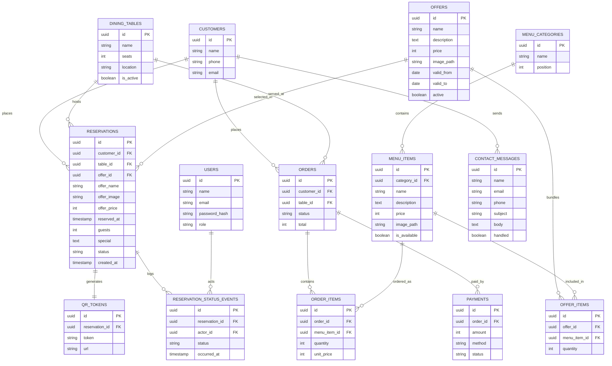

# ERD: Entity Relationship Diagram

This document specifies the data model for byte2bite, a restaurant storefront with a reservation service. It is derived from the current code: the storefront seed in `../lib/seed.js`, the offer catalogue in `../server/src/data/offers.js`, the reservation service in `../server/src/services/reservations.js`, and the JSON store in `../server/src/services/store.js`.

Two views are given. The relational target is the normalized model a production build would use. The prototype view describes what exists today, a single JSON file plus in-code constants and seed data.

## Conventions

- Every production table carries `id` (uuid, primary key) and `created_at`, `updated_at` unless noted.
- Money is stored as integer minor units (centavos). The UI shows the peso symbol, set as `currency` in the seed.
- The current prototype persists reservations as an array of JSON objects in `server/data/reservations.json`. Everything else is code or constant data.

## Diagram



## Entity dictionary

### Reservation service

| Entity | Key fields | Notes |
| --- | --- | --- |
| customers | id, name, phone, email | The prototype embeds these fields on the reservation instead of a separate record. |
| dining_tables | id, name, seats, location, is_active | Maps to the `TABLES` constant (t1 to t4) in `reservations.js`. |
| reservations | id, customer_id, table_id, offer_id, reserved_at, guests, special, status, created_at | The core record. Prototype field names are name, phone, email, datetime, guests, tableId, tableName, seats, offerId, offerName, offerImg, offerPrice, special. The offer fields are a denormalized snapshot of the catalogue at booking time, so a later price change does not rewrite history. |
| reservation_status_events | id, reservation_id, actor_id, status, occurred_at | Optional audit of status changes. Not present in the prototype. |
| qr_tokens | id, reservation_id, token, url | The prototype derives the QR from the view URL, so no token row is stored. |

### Storefront content

| Entity | Key fields | Notes |
| --- | --- | --- |
| menu_categories | id, name, position | Drinks and offers act as categories in the prototype seed. |
| menu_items | id, category_id, name, description, price, image_path, is_available | Maps to `drinks_seed` in `lib/seed.js`. |
| offers | id, name, description, price, image_path, valid_from, valid_to, active | Maps to `offers_seed`. Ids look like `offer-1`. The catalogue is re-exported for the server by `server/src/data/offers.js` (`listOffers`, `findOffer`) and served at `GET /api/offers`. |
| offer_items | id, offer_id, menu_item_id, quantity | Optional bundle composition, not present in the prototype. |

### Ordering (future)

| Entity | Key fields | Notes |
| --- | --- | --- |
| orders | id, customer_id, table_id, status, total | The Order now buttons point at `#` today. This is the target when ordering is built. |
| order_items | id, order_id, menu_item_id, quantity, unit_price | Line items. |
| payments | id, order_id, amount, method, status | Handled by a payment provider, not hand-rolled. |

### Staff and messaging

| Entity | Key fields | Notes |
| --- | --- | --- |
| users | id, name, email, password_hash, role | Staff and admin accounts. The Sign in button exists but is not wired. |
| contact_messages | id, name, email, phone, subject, body, handled | Captured from the contact page. Not persisted in the prototype. |

## Relationship summary

| Relationship | Cardinality | Meaning |
| --- | --- | --- |
| customers to reservations | 1 to many | A customer places many reservations. |
| dining_tables to reservations | 1 to many | A table hosts many reservations over time. |
| offers to reservations | 1 to many | An offer is selected by many reservations. Each reservation snapshots the chosen offer. |
| reservations to qr_tokens | 1 to 1 | Each reservation has one QR code. |
| reservations to reservation_status_events | 1 to many | A reservation has many status changes. |
| menu_categories to menu_items | 1 to many | A category holds many items. |
| offers to offer_items | 1 to many | An offer bundles many items. |
| menu_items to offer_items | 1 to many | An item can appear in many offers. |
| orders to order_items | 1 to many | An order has many line items. |
| orders to payments | 1 to many | An order can have many payment attempts. |

## Prototype mapping

The current build stores almost nothing in a database. The mapping is:

- `reservations` live in `server/data/reservations.json` as an array. `store.js` provides `list`, `find`, `insert`, and `remove`. `insert` prepends, so the newest reservation is first.
- `dining_tables` are the `TABLES` constant in `reservations.js` (t1 to t4 with seat counts 2, 4, 4, 6).
- `menu_items` and `offers` are the `drinks_seed` and `offers_seed` arrays in `lib/seed.js`, with the `carousel` array for hero slides and a shared `currency` symbol.
- `offers` are also exposed to the server through `server/src/data/offers.js`, which reads `offers_seed` and builds an id keyed catalogue (`offer-1` to `offer-6`). `GET /api/offers` lists them, and `POST /api/reservations` validates the submitted `offerId` against this catalogue so a client cannot invent a name or price.
- The site pages are static HTML. `about/`, `contact/`, and the home page carry no stored data. The offers section moved from its own page onto the home page.
- `qr_tokens` do not exist. The QR is generated on demand from the URL `${BASE_URL}/r/{id}`, both as a data URL for the response and as a PNG at `GET /api/reservations/:id/qr.png`.
- `customers` are not separate. Name, phone, and email are embedded on each reservation.
- `contact_messages`, `users`, `orders`, and `payments` do not exist yet.

A reservation object as stored today:

```
{
  "id": "ab12cd34ef",
  "createdAt": "2026-10-15T10:00:00.000Z",
  "name": "Jane Cruz",
  "phone": "+639123456789",
  "email": "jane@example.com",
  "datetime": "2026-10-20T18:30",
  "guests": 4,
  "tableId": "t1",
  "tableName": "Table 1",
  "seats": 2,
  "offerId": "offer-4",
  "offerName": "UNLI CHICKEN WINGS",
  "offerImg": "assets/offers/caro4.jpg",
  "offerPrice": 299,
  "special": "Window seat"
}
```

## Known gaps

- The client reads the table radio `value` (`T1` to `T4`) and `normalize` also strips a leading `table-`, so both `t1` and `table-t1` resolve to a table. The earlier always-falls-back-to-Table-1 bug is fixed at line 27 of `reservations.js`.
- `offerId` is required and validated against the catalogue in `offers.js`. A missing or unknown offer returns 400.
- Reservations have no status field and no capacity or double-booking check beyond the per-request guest clamp of 1 to 10.
