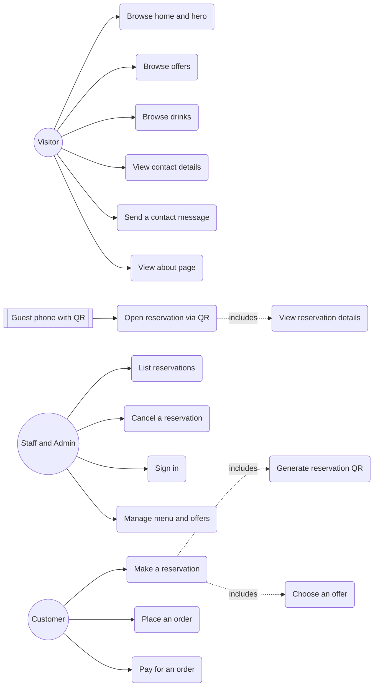

# Use Case

This document describes what each actor does in byte2bite, a restaurant storefront with a table reservation service. It covers the actors, a use case diagram, a summary of every use case, and full descriptions for the key ones.

## Actors

| Actor | Type | Description |
| --- | --- | --- |
| Visitor | Primary | Anyone browsing the storefront: home, offers, drinks, contact. |
| Customer | Primary | A visitor who books a table and receives a QR code. |
| Staff and Admin | Primary | Restaurant staff who list and cancel reservations and manage content. |
| Guest phone with QR | Secondary | The device that scans the QR and opens the reservation view. |
| Payment Provider | Secondary | Handles payment for orders. Planned, not built. |
| Notification Service | Secondary | Sends confirmations and reminders. Planned, not built. |

The storefront pages are public. There is no signed-in state yet, only a Sign in button that is not wired.

## Use case diagram

Use cases 13, 14, and 15 are planned.

## Summary

| ID | Use case | Primary actor | Part |
| --- | --- | --- | --- |
| UC-01 | Browse home and hero carousel | Visitor | Storefront |
| UC-02 | Browse offers (home section) | Visitor | Storefront |
| UC-03 | Browse drinks menu | Visitor | Storefront |
| UC-04 | View contact details | Visitor | Storefront |
| UC-05 | Send a contact message | Visitor | Storefront |
| UC-06 | Make a reservation | Customer | Reservation |
| UC-07 | Generate reservation QR | System | Reservation |
| UC-08 | Open reservation via QR | Guest phone with QR | Reservation |
| UC-09 | View reservation details | Customer, Staff | Reservation |
| UC-10 | List reservations | Staff and Admin | Reservation |
| UC-11 | Cancel a reservation | Staff and Admin | Reservation |
| UC-12 | Sign in | Staff and Admin | Storefront |
| UC-13 | Manage menu and offers | Staff and Admin | Content (planned) |
| UC-14 | Place an order | Customer | Ordering (planned) |
| UC-15 | Pay for an order | Customer | Ordering (planned) |
| UC-16 | View about page | Visitor | Storefront |
| UC-17 | Choose an offer | Customer | Reservation |

## Detailed use cases

### UC-06 Make a reservation

- Actor: Customer.
- Goal: book a table and receive a QR code for the booking.
- Preconditions: the customer is on the reservation page and the reservation service is reachable.
- Trigger: the customer submits the reservation form.
- Main flow:
  1. The customer enters name, phone, optional email, date and time, number of guests, a table, an offer, and optional requests (include UC-17 Choose an offer).
  2. The page posts the payload to `POST /api/reservations`.
  3. The service trims the text fields and clamps guests to the range 1 to 10.
  4. The service resolves the table, validates the offer against the catalogue, and snapshots the offer name, image, and price.
  5. The service stores the reservation and returns the reservation, a view url, a QR data url, and the estimated total.
  6. The page shows the QR and a link to the view page.
- Alternate flows:
  - 1a. A required field is missing. The form does not submit.
  - 3a. Name, phone, date, or guests is missing at the server. The service returns 400 with a message and the page shows the error.
  - 4a. `offerId` is missing or unknown. The service returns 400 with the message `offerId is required` or `Unknown offer: {id}`, and the page shows it.
  - 2a. The server is unreachable. The page shows a message to start the server and try again.
- Postconditions: the reservation exists in the store and the customer holds a QR that resolves to the view page.

### UC-17 Choose an offer

- Actor: Customer.
- Goal: bundle a deal with the table booking.
- Preconditions: the customer is on the reservation page and the seed has loaded.
- Trigger: included by UC-06. The offer picker renders when the page loads.
- Main flow:
  1. `reservation.js` reads `offers_seed` and `currency` from the shared seed.
  2. It renders one radio card per offer, each showing the poster, name, and price.
  3. The first offer is selected by default.
  4. The chosen offer's id is sent as `offerId` with the reservation.
- Alternate flows:
  - 1a. The seed is missing or empty. The picker stays empty and the submitted `offerId` fails server validation.
- Postconditions: the reservation carries the chosen offer, snapshotted at booking time.

### UC-07 Generate reservation QR

- Actor: System.
- Goal: produce a scannable code that opens the reservation on any phone.
- Preconditions: a reservation with an id exists.
- Trigger: included by UC-06, and available on demand.
- Main flow:
  1. The service builds the view url `${BASE_URL}/r/{id}`.
  2. It encodes the url with the `qrcode` library at medium error correction.
  3. It returns a data url in the create response, and a png at `GET /api/reservations/:id/qr.png`.
- Alternate flows:
  - 1a. `BASE_URL` is not reachable from the scanning phone, for example localhost. The QR encodes an address the phone cannot open.
- Postconditions: a QR image that encodes the reservation view url.

### UC-08 Open reservation via QR

- Actor: Guest phone with QR.
- Goal: open and read a reservation from a scanned code.
- Preconditions: the phone has a QR reader and the reservation exists.
- Trigger: the phone scans the QR, which opens `/r/{id}`.
- Main flow:
  1. The route `/r/{id}` looks up the reservation by id.
  2. If found, it redirects to `/view.html?id={id}`.
  3. The view page fetches `GET /api/reservations/{id}` and renders name, table and seats, guests, date and time, the chosen offer with its poster and price, the estimated total, phone, email, and requests.
- Alternate flows:
  - 1a. The id is unknown. `/r/{id}` returns a not found page.
  - 3a. The fetch fails or returns not found. The view page shows a not found message.
- Postconditions: the reservation details are shown on the phone.

### UC-11 Cancel a reservation

- Actor: Staff and Admin.
- Goal: remove a reservation.
- Preconditions: the reservation exists.
- Trigger: a delete request to `DELETE /api/reservations/{id}`.
- Main flow:
  1. The client sends a delete for the id.
  2. The service finds and removes the row.
  3. The service returns 204 with no body.
- Alternate flows:
  - 2a. The id is unknown. The service returns 404 with an error.
- Postconditions: the reservation no longer exists and its QR leads to a not found page. There is no confirmation step and no authentication today.

### UC-05 Send a contact message

- Actor: Visitor.
- Goal: reach the restaurant about a question or a large booking.
- Preconditions: the visitor is on the contact page.
- Trigger: the visitor opens the contact form.
- Main flow:
  1. The visitor reviews the address, phone, and email.
  2. The visitor fills the contact form and submits.
- Alternate flows:
  - 1a. The visitor prefers a direct channel and taps the phone or email link.
- Postconditions: a message is sent. In the prototype there is no contact form submission endpoint, so this use case is partly served by the direct phone, email, and map links on the page.

## Relationships

- Include: UC-06 includes UC-07 and UC-17. UC-08 includes UC-09.
- Secondary actors: the Guest phone participates in UC-08. The Payment Provider would participate in UC-15 and the Notification Service in UC-06 and UC-11 once built.
- Planned: UC-13, UC-14, and UC-15 are on the roadmap and are not implemented.
